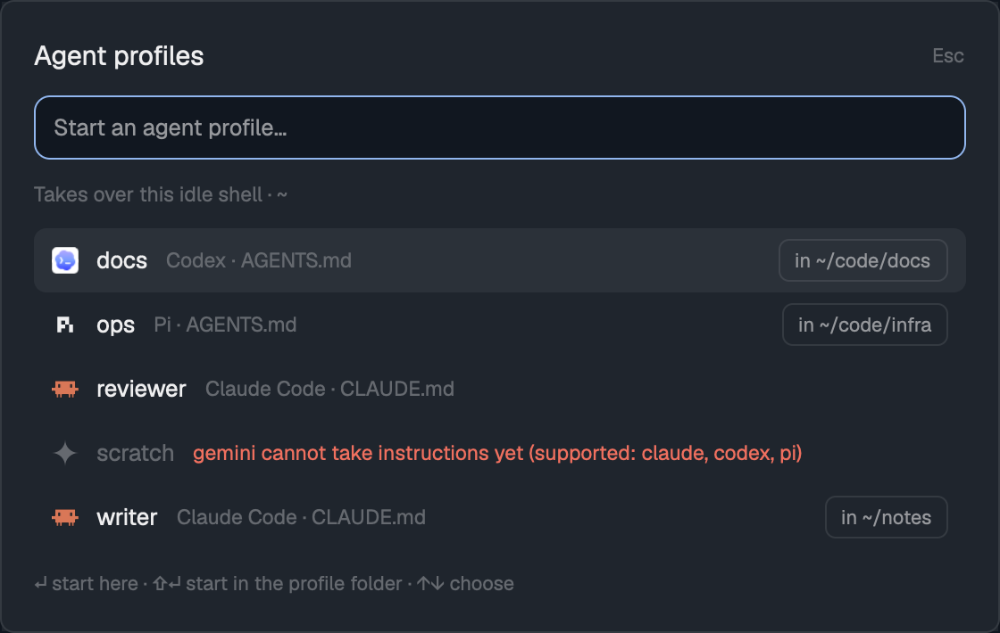

# Agent profiles for Herdr

A [Herdr](https://herdr.dev) mod. Save an agent once: its harness (Claude Code, Codex, Pi) and its
`AGENTS.md` / `CLAUDE.md`. Then start it in the pane you are looking at, in the folder you are in or
in the agent's own folder. The instructions go with it every time.



- **`ctrl-shift-a`** opens the list. Type to filter.
- **Enter** starts the agent here: in the focused pane, in that pane's current folder.
- **Shift+Enter** (or click `in ~/code/app`) starts it in the profile's own folder.
- The instructions are attached the harness's own way, in both cases. Nothing is pasted as a first message.

The same idea as the native agent profiles in [OhMyHerdr](https://github.com/chengyixu/oh-my-herdr),
as a mod for the Herdr app.

## Install

```sh
git clone https://github.com/chengyixu/herdr-agent-profiles
cd herdr-agent-profiles
bash scripts/install.sh
```

That copies `agent-profiles/mods/agent-profiles/` into `~/.config/herdr-app/mods/` and checks that
it loads. Then add the key. Merge `agent-profiles/keys.json` into your own `~/.config/herdr-app/keys.json`
(do not replace the file):

```json
{
  "global": { "ctrl-shift-a": "mod.open:agent-profiles" },
  "terminal": { "ctrl-shift-a": "mod.open:agent-profiles" }
}
```

The `terminal` entry takes Ctrl+Shift+A away from programs inside a terminal. Pick another key if you need it.

## Make a profile

One folder per agent, in `~/.config/herdr-app/agent-profiles/`. The folder name is the agent's name
(`a-z`, `0-9`, `-`, `_`; up to 32 characters; starts with a letter).

```
~/.config/herdr-app/agent-profiles/
└── nexora/
    ├── profile.json     { "harness": "claude", "cwd": "~/code/nexora" }
    └── CLAUDE.md        the persistent instructions (AGENTS.md works too)
```

| `profile.json` | |
|---|---|
| `harness` | Required. The key of an agent in Herdr's program table: `claude`, `codex`, `pi`, ... |
| `cwd` | Optional. The agent's own folder: an absolute path or `~/...`. Without it, only "start here" is offered. |

Unknown fields are an error, not ignored, so a typo cannot silently change what starts.
Copy the folders in [`examples/profiles/`](examples/profiles) to try it.

The document is `AGENTS.md` or `CLAUDE.md`. The harness's own name wins when both exist, so a profile
survives a change of harness. A blank document counts as none.

## What "start here" does

| The focused pane is | Result |
|---|---|
| An idle shell with nothing running under it | The agent **takes its place**: same slot, same size, same focus. A maximized pane stays maximized. |
| Anything else: a running program, an agent, a mod, a shell that owns sub-agents | The agent opens **beside** it. Nothing that runs is ever closed. |

The dialog says which one will happen before you choose. A new terminal is always created first; the old
pane is closed only after that worked. If the agent cannot start, the old pane is untouched.

## Harnesses

| Harness | How the document is attached | Checked against |
|---|---|---|
| Claude Code | `--append-system-prompt-file <path>` | `claude` 2.1.316: a live model returned a marker from the file |
| Pi | `--append-system-prompt <path>` | `pi` 1.5.2: the marker is in the assembled system prompt |
| Codex | `-c developer_instructions=<text>` | `codex` 0.166.0: the text is a `developer` message, verbatim |

Codex gets the text as *additional* developer instructions. The `model_instructions_file` option replaces
Codex's built-in prompt, so it is not used.

Another harness starts fine **without** a document. With a document it is refused with a clear message
("gemini cannot take instructions yet") rather than started without its instructions. To add one, add a line to `ADAPTERS` in `core.js` and a check
to `scripts/verify-harnesses.mjs`.

The command that starts the harness is Herdr's own (`programs.json`, `run`). To add flags, change it there
and every profile follows:

```json
{ "programs": { "claude": { "run": ["claude", "--model", "opus"] } } }
```

## How it works

```
main.js    the dialog; wires Herdr's APIs into core's `host`        (UI, thin)
core.js    parse a profile, pick the document, plan the launch,     (pure: imports nothing)
           decide replace or beside, and run the steps in order
```

`core.js` returns the steps; `main.js` runs them with `herdr-app do`, the app's own command line, because
it answers with what it made or why it could not, and the next step depends on that.

1. Read the profile folder: `profile.json` and the document.
2. Ask Herdr which agents exist and how to start each (`knownAgents()`).
3. Build the argument list: the harness command, then the instruction flag.
4. Wrap it in your login shell: `$SHELL -l -i -c '"$@"; exec "$0" -l -i' $SHELL <command...>`.
   Herdr starts a split pane's program directly with a bare PATH, so tools installed by nvm or a shell profile
   would not be found. The login shell finds them, the arguments travel unquoted and byte for byte,
   and a shell stays open after the agent exits, as with Herdr's own menu.
5. `terminal.open` beside the focused pane, in the chosen folder. Then, for an idle shell, `pane.close` on
   the old pane (and `pane.zoom` on the new one if the old was maximized).

Why these choices are in [`docs/adr/0001`](docs/adr/0001-spawn-into-the-current-pane.md).

## Good to know

- Local spaces only. In a space on another machine the dialog says so and starts nothing.
- Login shells: zsh, bash, sh, dash, ksh. fish and others are refused with a message until verified.
- What the mod touches: it reads `~/.config/herdr-app/agent-profiles/`, runs `herdr-app do ...` and
  `sh -c 'printf %s "$SHELL"'`, and starts the harness you chose. No network access of its own.
- Replacing an idle shell ends that shell. Only an idle shell with no sub-agents is replaced.

## Develop

```sh
npm test                          # unit tests + the UI glue under Node (no dependencies)
bash scripts/verify-source.sh     # tests, guards, contract checks against the real CLIs, `herdr-app check`
node scripts/e2e-live.mjs         # opt-in: the real flow in a running Herdr, in a throwaway space
```

[`CONTEXT.md`](CONTEXT.md) has the environment, what was verified, and the bugs found on the way.

MIT licensed.
