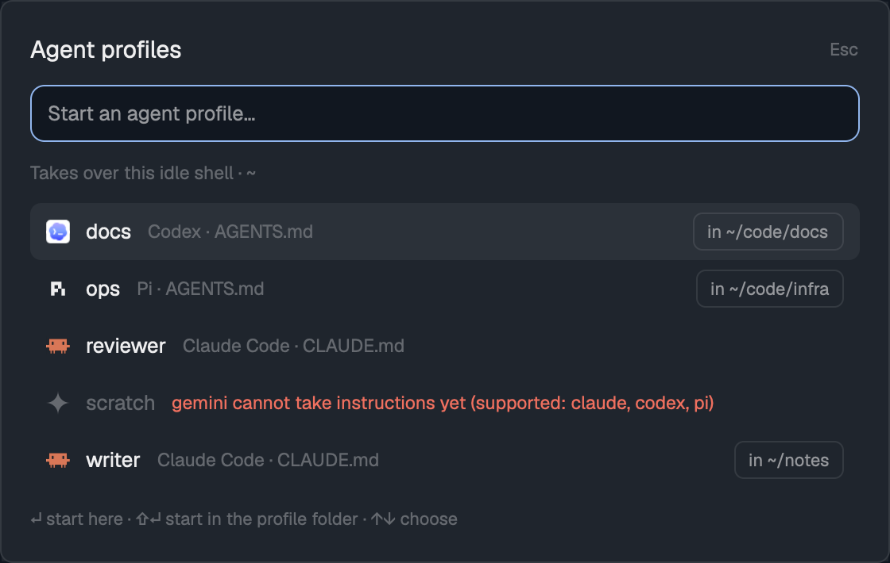

# Agent profiles

Save an agent once, as a folder: its harness (Claude Code, Codex or Pi) and its `AGENTS.md` / `CLAUDE.md`. Press a key, pick it, and it starts in the pane you are in, in the folder you are in or in the agent's own folder, with its instructions attached the harness's own way. This is a piece you add to your current layout, not a whole window.



This file is the brief: enough to build Agent profiles from an empty folder. The files next to it are one build of it. If they don't work on your Herdr, or you want it different, build it again from here.

## What you see

- A popup near the top of the window, 560px wide and 420px high, offset 64px from the top.
- Optionally, a "Profiles" block in the sidebar, under Herdr's Agents list, in the person's own copy of their layout (Herdr's layouts are read-only). It matches the Agents list: theme `chrome` background, a 1px `border` line on top, a 41px header "Profiles" (11.5px, medium, `dim`), then 30px rows with 8px rounding: the harness icon (16px), the name (13px; `dim` when it cannot start), and, for a profile with a `cwd`, a 13px folder icon on the right (`dim`, `foreground` on hover). Hovering a row shows "name · harness · documents", or the reason it cannot start. While one starts, its row says "starting…". With no profiles: "No profiles yet. Add a folder per agent in ~/.config/herdr-app/agent-profiles/." On the narrow rail (sidebar under 160px) there is no header and each row is only its centered icon, 26px high.
- A heading, "Agent profiles" (15px, semibold), with "Esc" on the right in the dim text color.
- A filter field, 36px high, rounded, with an accent-colored border and the placeholder "Start an agent profile…".
- One hint line under it (11.5px). Normally dim: "Takes over this idle shell · ~/folder" or "Opens beside this pane · ~/folder". In the blocked color: "This space is on <machine>. Remote spaces are not supported yet." or "Focus a pane first." While a start is running: "Starting <name>…" in the accent color.
- A scrollable list of rows, 36px high. Each row: the harness icon (15px; one-color icons take the text color), the profile name (semibold), then a dim "<Harness name> · <documents>": the included profiles' names and then its own file name, joined by " + " (for example "Claude Code · general + CLAUDE.md"), or "no instructions". If the profile has a `cwd`, a bordered 24px chip on the right reads "in <cwd>".
- A row that cannot start shows its name dim and the reason in the blocked color instead of the harness line, and has no chip.
- With no profile folder: "No profiles yet. Make a folder named after the agent in ~/.config/herdr-app/agent-profiles/ with two files:" and the two example lines `profile.json   {"harness": "claude", "cwd": "~/code/app"}` and `AGENTS.md      its instructions (CLAUDE.md works too)`. With a filter that matches nothing: "No profile matches."
- A footer (11px, dim): "↵ start here · ⇧↵ start in the profile folder · ↑↓ choose", shown only when there is at least one profile.
- Theme colors only (`popover`, `background`, `accent`, `hover`, `border`, `foreground`, `muted`, `dim`, `blocked`). Text 13px.

- Right-clicking a sidebar row opens an options menu at the pointer: a popup 300px wide, as tall as its rows (Herdr keeps it inside the window), on the `popover` background with 5px padding, text 12.8px. From the top: the profile name (semibold) over a dim line, "<Harness> · <documents>" or, in the `blocked` color, why it cannot start; "Start here" and "Start in <cwd>" (or a dim "Start in its folder"); then, each under a 11px `dim` section title and after a 1px `border` divider: "Harness" (Claude Code, Codex and Pi when installed, plus the current harness if it is another; the current one has an `accent` ✓), "Folder" (the folder with a dim "change…", or "Choose a folder…"; and "None: start where you are"; ✓ on the one in effect), "Also attach the instructions of" (one row per profile that can be included, ✓ when included; or a dim note "Attached by a, b: it cannot attach others" or "No other profile has instructions to attach"); then "Edit instructions" (dim hint: the file name, or "new CLAUDE.md"/"new AGENTS.md"), "Edit profile.json" and "Show in Finder" ("Show the folder" off macOS). Rows are 28px with 6px rounding and a `selected` hover. A profile whose `profile.json` cannot be read shows only the start rows (dim) and the file rows.

## How it behaves

The key (`ctrl-shift-a`) opens the popup with the filter focused. The focused pane, its folder and its space are read once, at that moment. Profiles are read from `agent-profiles/` in the app home, one per folder, sorted by name; folders starting with `.` and loose files are ignored.

- Typing filters by name or harness and puts the selection on the first match. Up and down move it, wrapping, and scroll it into view.
- **Enter** starts the selected profile in the focused pane's current folder. **Shift+Enter**, **Cmd/Ctrl+Enter** or a click on the `in <cwd>` chip starts it in the profile's own folder (`~` and `~/...` expand to the home folder). A click on the row starts it here.
- The same instructions are attached in both cases.
- If the focused pane is an idle shell with no sub-agents under it, the agent **takes its place**: same slot, size and focus, and a maximized pane stays maximized. Otherwise (a running program, an agent, a mod pane, a shell that owns sub-agents) the agent opens **beside** it. Nothing that is running is ever closed.
- The new terminal is always created first. The old pane is closed only after that worked. If it cannot be created (for example, the folder does not exist) the old pane is untouched and an error toast says why.
- The popup stays open until the start has finished, shows "Starting <name>…", ignores a second start, then closes. A failure shows an error toast titled "Could not start <name>".
- A profile that cannot start (broken `profile.json`, harness unknown or not installed, a document for a harness with no verified way to attach it, an `include` that names no profile, a broken one, one without a document or one that includes others) is listed with the reason and cannot be chosen.
- Esc closes the popup. Nothing is written anywhere.

A profile is a folder: `profile.json` with `{"harness": "<program key>", "cwd": "<optional>", "include": ["<optional profile names>"]}` (unknown fields are an error) and a document, `AGENTS.md` or `CLAUDE.md`. The harness's own file name wins if both exist; a blank document counts as none. `include` attaches the named profiles' documents first, in order, so rules shared by several agents have one home; only their documents are used, not their harness or folder, and only one level deep.

In the sidebar block, a click on a row starts the profile in the focused pane at the moment of the click (if the click took focus off the panes, the last pane the block saw focused); a click on the folder icon starts it in the profile's own folder and not also the row's start. A second click while one is starting does nothing. The block reloads the profiles whenever the profile folder changes; without a folder it looks again every 10 seconds. It never takes keyboard focus.

The options menu: Option-click or Control-click on a row opens it too, and a right-click never starts anything. Start rows start the profile in the pane that was focused when the menu opened, then close the menu. Every other row acts and leaves the menu open, showing the new state: a harness row sets `harness`; "Choose a folder…" opens the system folder picker and stores the folder as `~/...` under the home folder (cancelling changes nothing and is not an error); "None" removes `cwd`; an attach row adds the profile to the end of `include` or removes it. Each change reads `profile.json`, rewrites it in one form (two-space JSON, empty `cwd`/`include` left out) and writes it only if the file is unchanged since that read; a change that would make it unloadable, or a file that does not load, is refused with an error toast and the file is left alone. "Edit instructions" creates an empty document named for the harness when there is none, then opens it in the text editor (`open -t`; `xdg-open` off macOS); "Edit profile.json" opens that (creating `{"harness": "<first installed agent>"}` if missing); "Show in Finder" reveals it (`open -R`). A failed action shows an error toast titled "<name>: could not do that".

## Built from

- **One mod**, `mods/agent-profiles/`: `mod.json` (`place: "none"`, a top popup overlay), `main.js` (picks the view per copy from `props().view`), `popup.js`, `sidebar.js`, `menu.js` (the options menu, `props: { view: "menu", profile, pane }`), `host.js` (Herdr wiring shared by both), `core.js` (all the logic, importing nothing, so it runs under Node for tests) and `folder.svg`. The bundle has no `layouts/` folder: the sidebar block goes into the person's own layout copy as `{ "id": "profiles", "type": "block", "size": { "weight": 1 }, "min": 90, "content": { "mod": "agent-profiles", "props": { "view": "sidebar" } } }`, after `agents` in the `sidebar-lists` column of a `layout.clone` of `main`.
- The menu uses `pickFolder`, `writeTextFile` (compare-and-swap: the text it read as `expected`, `null` to create), `exec` for `open`/`xdg-open` and `window().platform`. Its rows are data first (`menuItems`), so the sidebar sizes the popup with the same rows before opening it (`menuHeight`). Core gives it `editProfile`, `homeRelative`, `includeChoices` and `newDocName`.
- The sidebar uses `layout()` (the `sidebar` node's width, for the rail), `focused()` at click time and at each render (the last pane it saw), and `watchFolder` on the profile folder, with `cx.timer.after(10000)` before watching again when that fails.
- **A `keys.json` snippet** merged into the person's existing keys, never replacing them:

  ```json
  {
    "global": { "ctrl-shift-a": "mod.open:agent-profiles" },
    "terminal": { "ctrl-shift-a": "mod.open:agent-profiles" }
  }
  ```
- **Herdr APIs:** `focused()`, `spaces()`, `panes()` (`terminal`, `cwd`, `status`, `zoomed`, `program.shell`), `terminals()` (`parent`, `state`), `knownAgents()` (`key`, `name`, `run`, `installed`, `icon`, `tint`), `exec`, `notify`, `appHome()`, `home()`, `props()`, `closeOverlay`, `theme()`, and `readdir` / `readFile` from `fs/promises`. UI from `gpui-kit` and `gpui-base` (`InputState`, `Input`, `ScrollHandle`, `h_flex`, `v_flex`). Host calls are made in `init`, never at module scope.
- **The harness command** is `knownAgents().run`, so `programs.json` overrides (extra flags) apply to every profile.
- **Attaching the documents**, one entry per harness in `ADAPTERS`, each given every document in order: Claude one `--append-system-prompt=<texts>` (Claude Code keeps only the last of a repeated `--append-system-prompt-file`; the `=` form keeps a document that starts with `-` from reading as a flag); Pi `--append-system-prompt <path>` once per document; Codex one `-c developer_instructions=<TOML string>` (the texts as a JSON string, with DEL written as `\u007f`; additive, unlike `model_instructions_file`, which replaces Codex's built-in prompt). Several texts are joined with a blank line. A harness not in the table is refused when its profile has a document. `resolveIncludes` in `core.js` turns the loaded profiles into each one's document list.
- **The launch** goes through `herdr-app do` (run with `exec`), because each step needs the answer from the one before:
  1. `pane.focus {pane}`
  2. `terminal.open {argv, folder?, place: "right"}` with `argv = [$SHELL, "-l", "-i", "-c", "\"$@\"; exec \"$0\" -l -i", $SHELL, ...harnessCommand, ...documentFlag]`. Herdr starts a split pane's program directly with a bare PATH, so the login shell is what finds nvm-installed tools; the arguments travel unquoted, and a shell stays open after the agent exits. `$SHELL` is read with `sh -c 'printf %s "$SHELL"'`.
  3. For an idle shell: `pane.close {pane: <old>}`, then `pane.zoom {pane: <new>}` if the old pane was zoomed.
- **Login shells** that were checked: zsh, bash, sh, dash, ksh. Any other (fish, for one) is refused with a message.
- Customization points: `ADAPTERS` and `POSIX_SHELLS` at the top of `core.js`; the size and offset in `mod.json`; the key in `keys.json`.

## Watch out

- **What it runs and reads.** It runs `herdr-app do ...` and `sh -c 'printf %s "$SHELL"'`, starts the harness you chose through your login shell, and reads `~/.config/herdr-app/agent-profiles/` (outside the mod's own folder). It has no network access of its own. Disclose this before adding it.
- `ctrl-shift-a` is taken from programs in a terminal by the `terminal` binding. Pick another key if you need it.
- Replacing an idle shell **ends that shell**: its history and variables go. That is why only an idle shell with no sub-agents is replaced.
- Local spaces only. In a space on another machine the popup says so and starts nothing: the document and folder are on this machine.
- A document for a harness without a verified adapter makes that profile unusable; it is never silently dropped. Add the harness to `ADAPTERS` only after proving the flag against the real CLI.
- `profile.json` rejects unknown fields on purpose. A key from another tool (`native_cwd`, for example) is an error, not ignored.
- Pi blanks its own command line, so the flag cannot be read back from the running process; the launch argv the core records can.
- `herdr-app check` writes `gpui-kit.d.ts` and `jsconfig.json` into the mod folder. Keep them out of anything you share.
- A covered or occluded window returns a stale frame from `herdr-app shot`. Take the preview while the window is visible, crop it to the popup, and use only demo profiles.
- Checked against Herdr 0.1.15 with herdr-core 0.1.20, Claude Code 2.1.316, Codex 0.166.0 and Pi 1.5.2 on macOS arm64. Other versions and platforms: unknown.

## Done when

Checked while building (on the versions above):

- `herdr-app check mods/agent-profiles` passes.
- The unit tests (the rules and the order of the steps) and the UI-glue tests (loading, row states, click, Enter, Shift+Enter, failure toast, double-start guard) pass, and each dangerous mutation turns a test red.
- The wrapper delivers a 20 KB argument with quotes, `$`, backticks, CRLF, DEL, CJK and emoji byte for byte through zsh, bash, sh, dash and ksh.
- Each harness takes two documents, the included one first: Claude answers with a marker from each (the first document starts with "- "); Pi's assembled system prompt contains both, in order; Codex's model-visible prompt contains both as one developer message, in order. Each is absent without the flag.
- In a running Herdr, with real Claude, Pi and Codex: an idle shell is replaced by the agent in the same slot; the agent is the foreground process in the requested folder, launched with an included and its own document attached, the included one first; a busy pane is left alone; a start into a folder that does not exist leaves the old pane untouched.
- In a running Herdr, once, with a stand-in agent (not a recurring script): a replaced maximized pane comes back maximized, and a maximized busy pane is split beside as splits normally are.

- The options menu opens from a real right-click position, inside the window, with every section showing (Herdr 0.1.15). Its writes, under tests: each setting rewrites `profile.json` as described, a cancelled picker and a broken file write nothing, a stale file is refused; the real `writeTextFile` was checked to create only a missing file, reject a stale one and replace a current one.

Still needs a person with a visible window:

- Right-click a profile, change its harness, folder (with the system picker) and attachments, open its instructions; check the list and the files follow.
- Open the popup with the key and use it with the keyboard and the mouse: filter, arrows, Enter, Shift+Enter, the `in <cwd>` chip, Esc, and a click on a row that cannot start.
- Look at the popup in your theme and at a narrow window width; the popup size is fixed.
- Confirm normal typing and your existing layout and keys are unchanged outside the popup.
